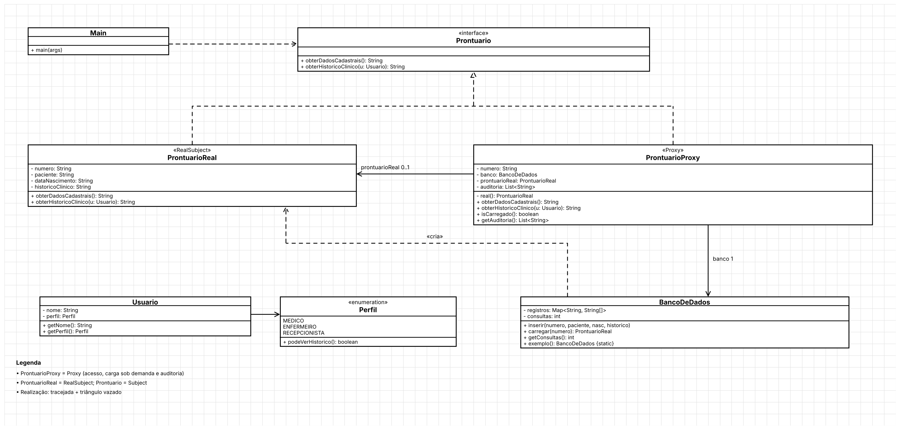

# Padrão Proxy — Prontuário eletrônico

Exemplo do padrão estrutural **Proxy**: `ProntuarioProxy` controla o acesso ao prontuário real. Faz proteção (só médico e enfermeiro veem o histórico clínico), carga sob demanda (o banco só é consultado na primeira necessidade, uma única vez) e auditoria de todos os acessos.

## Diagrama UML

## Participantes do padrão

| Papel | Classe |
|---|---|
| Subject | `Prontuario` |
| RealSubject | `ProntuarioReal` |
| Proxy | `ProntuarioProxy` |
| Apoio | `BancoDeDados`, `Usuario`, `Perfil` |

## Casos de teste (JUnit 5)

`ProntuarioProxyTest` (12 testes): proxy como Prontuario, carga preguiçosa, dados cadastrais, acesso por perfil (médico/enfermeiro liberados, recepcionista e usuário nulo negados), acesso negado não consulta o banco, uma única carga, auditoria, prontuário inexistente.

## Como executar

- **IntelliJ**: `File > Open` e selecione a pasta do projeto (o `pom.xml` é importado automaticamente; JDK 11).
  - Testes: botão direito em `src/test/java` > *Run 'All Tests'*.
  - Demonstração: execute a classe `padroesestruturais.proxy.Main`.
- **Maven**: `mvn test`

O diagrama pode ser regerado com `python docs/gerar_uml.py` (requer matplotlib).
